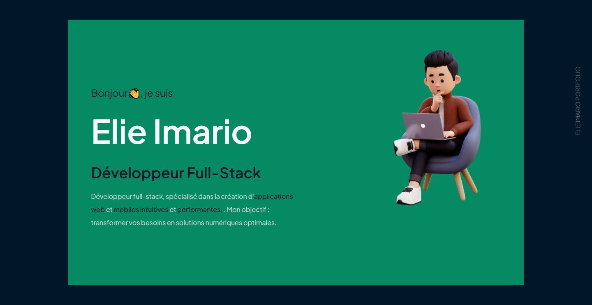
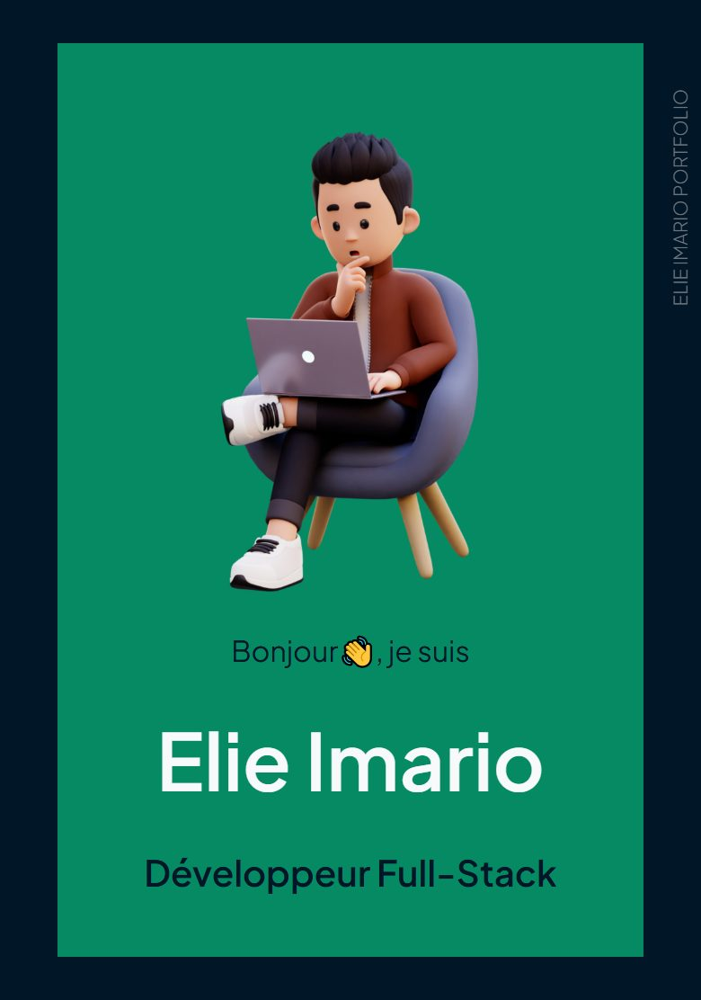

<div align="center">

# Elie Imario · Portfolio

Personal website of Elie Imario, full-stack developer: who I am, the technologies I work with,<br>
where I have worked and a selection of my projects.

[](https://imarioa.netlify.app/)
[](https://github.com/Elie-Imario/portfolio-web-app/actions/workflows/ci.yml)


<br>

&nbsp;&nbsp;

**[Visit the site →](https://imarioa.netlify.app/)**

</div>

## About the site

A one-page portfolio, written in French, that reads from top to bottom:

| Section | What it shows |
| --- | --- |
| **Home** | My name, my role and a one-line pitch |
| **About** | My background and my current focus |
| **Skills** | The languages and frameworks I have used, with their logos |
| **Experience** | Past positions on a vertical timeline, with what I did in each |
| **Services** | Web development, UX/UI and software development |
| **Projects** | Selected projects with a screenshot, their stack and a link to the code when it is public |
| **Contact** | An invitation to get in touch, my contact details and links to GitHub and LinkedIn |

The page opens with an animated intro, reveals each block as you scroll, draws a light beam along the content as you move down the page, and sends meteors across the project cards.

## Tech stack

| Area | Tools |
| --- | --- |
| Framework | [React](https://react.dev/) 18.3 and [TypeScript](https://www.typescriptlang.org/) 5.5 |
| Build | [Vite](https://vite.dev/) 5.4 with `@vitejs/plugin-react` |
| Styling | [Tailwind CSS](https://tailwindcss.com/) 3.4 and [Sass](https://sass-lang.com/); a `cn()` helper built on `clsx` and `tailwind-merge` |
| Animation | [GSAP](https://gsap.com/) 3.15 with `@gsap/react`, [framer-motion](https://motion.dev/) 11, ScrollReveal 4 |
| Components | `react-vertical-timeline-component`, [Font Awesome](https://fontawesome.com/) 6, `@artsy/fresnel` for breakpoint-specific layouts |
| Typography | Plus Jakarta Sans, self-hosted with [Fontsource](https://fontsource.org/) |
| Quality | ESLint 8 with `typescript-eslint`, `react-hooks` and `react-refresh` rules |

## Getting started

You need **Node.js 24**, pinned in [`.nvmrc`](.nvmrc), and the npm 11 that ships with it.

```bash
git clone https://github.com/Elie-Imario/portfolio-web-app.git
cd portfolio-web-app
nvm use          # reads .nvmrc; with nvm-windows, run: nvm use 24
npm ci
npm run dev      # http://localhost:5173
```

> [!NOTE]
> npm 11 only runs the install scripts of dependencies listed as approved under `allowScripts` in `package.json`; today that is esbuild alone. If an install reports a new package with install scripts, review it with `npm install-scripts ls` before approving it.

### Scripts

| Command | What it does |
| --- | --- |
| `npm run dev` | Starts the development server with hot reload. |
| `npm run build` | Type-checks with `tsc`, then builds the production site into `dist/`. |
| `npm run preview` | Serves `dist/` locally to check the production build. |
| `npm run lint` | Runs ESLint; a single warning fails the command. |

## Project structure

```text
portfolio-web-app/
├── .github/workflows/     CI and dependency review
├── docs/screenshots/      Images used in this README
├── public/                Files served as-is: skill icons, company logos, project screenshots
├── src/
│   ├── App.tsx            The page, section by section
│   ├── components/        Section items and visual effects (preloader, meteors, tracing beam)
│   ├── services/
│   │   ├── data/          Site content: skills, experience, services, projects
│   │   ├── types/         Types for that content
│   │   └── plugins/       Font loading
│   ├── assets/            Images and shared Sass (variables, mixins)
│   └── utils/             cn() class helper, ScrollReveal presets
└── .nvmrc                 Node.js version
```

## Updating the content

Most of the content is data rather than markup:

- Skills, experience, services and projects live in [`src/services/data/datas.ts`](src/services/data/datas.ts), typed by [`src/services/types/dataTypes.ts`](src/services/types/dataTypes.ts).
- Icons, company logos and project screenshots go in [`public/`](public) and are referenced by their path, for example `/icons/react_ts.svg`.
- A project with an empty `linkToGitHub` shows no GitHub button.

The introduction, the about text and the contact block are written directly in [`src/App.tsx`](src/App.tsx).

## Quality and CI

Every pull request to `main`, and every push to `main`, runs the [CI workflow](.github/workflows/ci.yml):

1. `npm ci` on the Node.js version from `.nvmrc`
2. `npm run lint`
3. `npm run build`, whose `dist/` folder is kept as a downloadable artifact for 7 days
4. `npm audit --omit=dev`, which fails on any known vulnerability in the site's runtime dependencies
5. `npm audit`, a full report that stays informational while the development tooling is upgraded

Pull requests also go through [dependency review](.github/workflows/dependency-review.yml), which blocks any new runtime dependency with a known vulnerability. Both workflows run with a read-only token and use actions pinned to full commit SHAs.

## Deployment

The site is fully static. Netlify builds and publishes `main` automatically at **[imarioa.netlify.app](https://imarioa.netlify.app/)**.

A move to Cloudflare Workers, with a preview address for every branch, is planned; this section will describe it once it is live.

## Roadmap

- [x] Restore the production build and update dependencies within their major versions
- [x] Pin Node.js 24
- [ ] Run lint, type-check, build and audits on every pull request
- [ ] End-to-end tests with Playwright
- [ ] Move to Vite 8, ESLint 10 and TypeScript 6
- [ ] Shorter preloader and lighter animations, with content visible without JavaScript
- [ ] Search engine optimization: pre-rendered HTML, metadata, optimized images
- [ ] English version under `/en/`
- [ ] Hosting on Cloudflare Workers

## License

No open-source license has been chosen yet, so the code is © Elie Imario, all rights reserved. Texts, photos, illustrations and project screenshots are not available for reuse.

## Contact

- Website: [imarioa.netlify.app](https://imarioa.netlify.app/)
- GitHub: [Elie-Imario](https://github.com/Elie-Imario)
- LinkedIn: [Elie Imario](https://www.linkedin.com/in/elie-imario-8844782b5)
